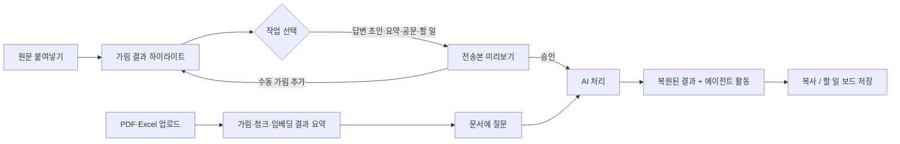
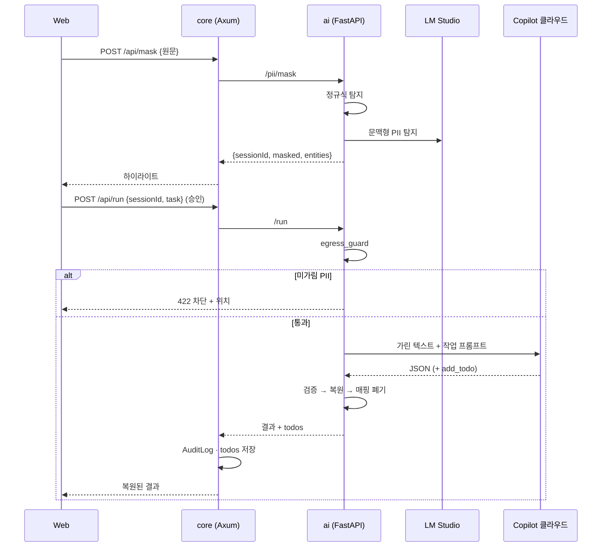
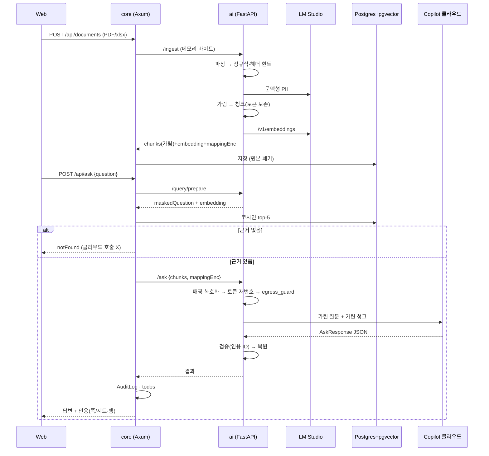

# 04. 플로우

## 1. 사용자 플로우

## 2. 데이터 플로우 — 붙여넣기

## 3. 데이터 플로우 — 문서 업로드·질의

## 4. 에러 플로우
| 상황 | 동작 |
|---|---|
| LM Studio 응답 없음 | 붙여넣기: 정규식만, 노란 배너 "문맥 탐지 꺼짐" / 업로드: "임베딩 서버 꺼짐" 안내 |
| egress_guard 차단 | 전송 안 함, 위치 빨간 표시, 수동 가림 버튼 |
| JSON 검증 실패 | 1회 재시도 → "답변 형식 오류, 다시 시도" |
| 클라우드 실패 | 1회 재시도 → 실패 안내, 매핑 유지(TTL 내 재시도) |
| 매핑표 만료 | "다시 가림 필요" 안내 |
| 지원 안 하는 파일 | 스캔 PDF·HWP·xls → 사유와 함께 거부 |

## 5. 화면
1. **작업대**: 좌 원문/가림 뷰 · 우 결과 · 상단 작업 버튼 4개 · 에이전트 활동 로그
2. **문서함**: 업로드 · 문서 목록(가린 항목 수, 청크 수) · 질문창 · 답변 + 인용 카드
3. **할 일 보드**: 오늘 / 이번 주 / 완료
4. **전송 기록**: 시각 · 종류(작업/질의/인덱싱) · 가린 항목 수 · 통과/차단
