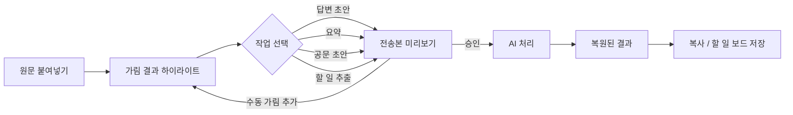
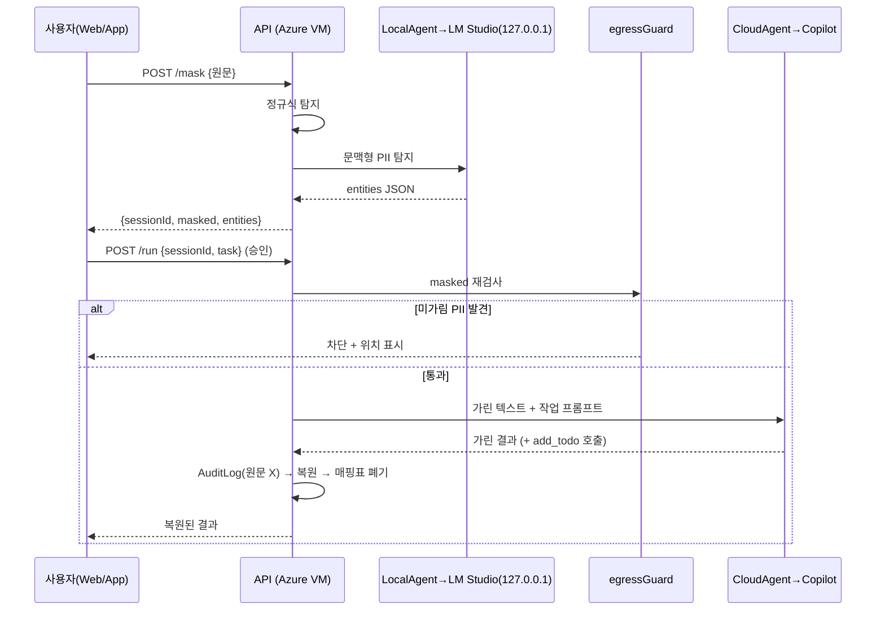

# 04. 플로우

## 1. 사용자 플로우

## 2. 데이터 플로우

## 3. 에러 플로우
| 상황 | 동작 |
|---|---|
| LM Studio 응답 없음 | 정규식만 적용, 노란 배너 "문맥 탐지 꺼짐" |
| egressGuard 차단 | 전송 안 함, 위치 빨간 표시, 수동 가림 버튼 |
| 클라우드 실패 | 1회 재시도 → 실패 안내, 매핑표 유지(TTL 내 재시도) |
| 매핑표 만료 | "다시 가림 필요" 안내 |

## 4. 화면
1. **작업대**: 좌 원문/가림 뷰 · 우 결과 · 상단 작업 버튼 4개
2. **할 일 보드**: 오늘 / 이번 주 / 완료
3. **전송 기록**: 시각 · 작업 · 가린 항목 수 · 통과/차단
